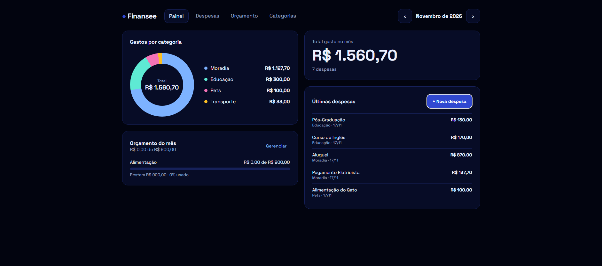
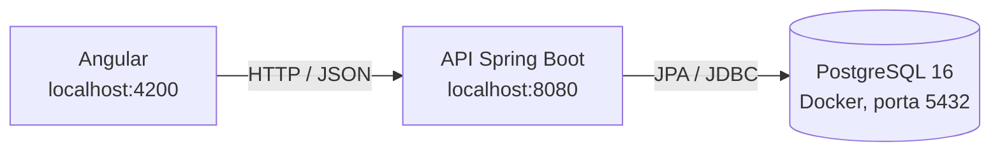
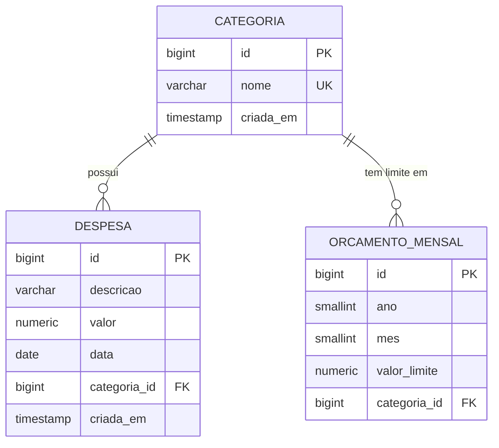

# Finansee

Aplicação web para **gerenciar gastos mensais**: registre despesas, organize por categoria, defina um orçamento para cada mês e acompanhe tudo em um painel.


> Projeto pessoal de estudo, em desenvolvimento. Por enquanto é de **um único usuário**, sem login.

## Capturas de tela



## Funcionalidades

- **Painel do mês:** total gasto, gráfico de rosca por categoria, últimas despesas e uso do orçamento.
- **Despesas:** cadastro, listagem do mês, edição e exclusão.
- **Categorias:** criar, renomear e excluir. Uma categoria em uso (com despesas ou orçamento) não pode ser excluída.
- **Orçamento mensal:** limite por categoria e por mês, com barra de progresso que muda de cor ao chegar em 80% do limite e ao ultrapassá-lo.
- **Navegação por mês** compartilhada entre as telas.

## Tecnologias

| Camada | Tecnologias |
|---|---|
| Front-end | Angular (componentes standalone, signals, Reactive Forms), RxJS, TypeScript, SCSS |
| Back-end | Java 21, Spring Boot (Web, Data JPA, Validation), Lombok, Maven |
| Banco de dados | PostgreSQL 16, migrations com Flyway |
| Infraestrutura | Docker Compose (banco, API e front-end com nginx) |
| Testes | JUnit 5, Mockito, AssertJ, Spring Boot Test, Testcontainers |

## Arquitetura



## Estrutura do repositório

```
finansee/
├── backend/                          # API REST (Spring Boot)
│   ├── Dockerfile                    # imagem do back-end (build em 2 estágios)
│   ├── .dockerignore
│   ├── pom.xml                       # dependências e build (Maven)
│   └── src/
│       ├── main/
│       │   ├── java/com/finansee/backend/
│       │   │   ├── categoria/        # entidade, repository, service, controller e DTOs
│       │   │   ├── despesa/
│       │   │   ├── orcamento/
│       │   │   ├── resumo/           # resumo mensal (totais, por categoria, orçamento)
│       │   │   ├── comum/            # utilitários compartilhados
│       │   │   ├── config/           # CORS
│       │   │   └── excecao/          # exceções e tratamento de erros
│       │   └── resources/
│       │       ├── application.yml
│       │       └── db/migration/     # migrations do Flyway
│       └── test/java/com/finansee/backend/
│           ├── comum/                # testes unitários de PeriodoMensal
│           ├── categoria/            # testes unitários de CategoriaService
│           ├── resumo/               # testes unitários de ResumoService
│           ├── despesa/              # testes de integração dos repositories
│           └── TestcontainersConfiguration.java   # PostgreSQL descartável nos testes
├── frontend/                         # aplicação Angular
│   ├── Dockerfile                    # imagem do front-end (build + nginx)
│   ├── nginx.conf                    # serve o Angular e repassa /api ao back-end
│   ├── .dockerignore
│   ├── proxy.conf.json               # proxy do ng serve para a API local
│   └── src/app/
│       ├── cabecalho/                # menu e seletor de mês
│       ├── compartilhado/            # componentes usados em mais de uma tela
│       ├── core/                     # services, modelos e endereço da API
│       ├── painel/
│       ├── despesas/
│       ├── categorias/
│       └── orcamento/
├── docs/                             # imagens usadas no README
├── .env.example                      # modelo das variáveis do banco (copie para .env)
├── docker-compose.yml                # banco, API e front-end
└── README.md
```

## Como executar

### Pré-requisitos

- [Git](https://git-scm.com)
- [Docker Desktop](https://www.docker.com/products/docker-desktop/)
- JDK 21
- [Node.js](https://nodejs.org) (versão LTS) e npm
- Angular CLI: `npm install -g @angular/cli`

### Passo a passo

**1. Clonar o repositório**

```bash
git clone https://github.com/GabrielFDevelop/finansee.git
cd finansee
```

### Opção A: tudo com Docker

```bash
cp .env.example .env
docker compose up -d --build
```

No Windows (PowerShell), troque o `cp` por `Copy-Item .env.example .env`.

A aplicação fica em http://localhost:8081. Na primeira vez, o build leva alguns minutos.

### Opção B: desenvolvimento (banco no Docker, aplicações locais)

**1. Subir o banco**

```bash
cp .env.example .env
docker compose up -d db
```

**2. Subir o back-end** (em um terminal)

```bash
cd backend
./mvnw spring-boot:run
```

No Windows (PowerShell), use `.\mvnw.cmd spring-boot:run`.

**3. Subir o front-end** (em outro terminal)

```bash
cd frontend
npm install
ng serve
```

O `ng serve` encaminha as chamadas `/api` para o back-end local (`proxy.conf.json`).

### Endereços

| Serviço | Opção A (Docker) | Opção B (desenvolvimento) |
|---|---|---|
| Aplicação | http://localhost:8081 | http://localhost:4200 |
| API | http://localhost:8080/api | http://localhost:8080/api |
| PostgreSQL | `localhost:5432` | `localhost:5432` |

As credenciais do banco ficam no arquivo `.env` (que não vai para o Git). O `.env.example` é o modelo.

### Parar

- Back-end e front-end: `Ctrl + C` no terminal de cada um.
- Banco, preservando os dados: `docker compose stop`.
- Remover o container (os dados continuam no volume): `docker compose down`.
- Remover também os dados: `docker compose down -v`.

## API

| Recurso | Endpoints |
|---|---|
| Categorias | `GET /api/categorias`, `GET /api/categorias/{id}`, `POST /api/categorias`, `PUT /api/categorias/{id}`, `DELETE /api/categorias/{id}` |
| Despesas | `GET /api/despesas?ano=&mes=`, `GET /api/despesas/{id}`, `POST /api/despesas`, `PUT /api/despesas/{id}`, `DELETE /api/despesas/{id}` |
| Resumo mensal | `GET /api/resumo?ano=&mes=` |
| Orçamento | `GET /api/orcamentos?ano=&mes=`, `PUT /api/orcamentos/{ano}/{mes}/{categoriaId}`, `DELETE /api/orcamentos/{ano}/{mes}/{categoriaId}` |

Quando `ano` e `mes` não são informados, a API usa o mês atual.

Exemplo, definindo um limite de R$ 900,00 para a categoria 1 em novembro de 2026:

```http
PUT /api/orcamentos/2026/11/1
Content-Type: application/json

{ "valorLimite": 900.00 }
```

Os erros seguem o formato `ProblemDetail` (RFC 9457):

| Status | Quando acontece |
|---|---|
| `400` | Dados inválidos (a resposta traz a lista `erros` por campo), mês fora de 1 a 12, ano fora do intervalo permitido |
| `404` | Despesa, categoria ou orçamento inexistente |
| `409` | Nome de categoria duplicado ou categoria em uso |

## Banco de dados



O esquema é versionado com **Flyway**, em `backend/src/main/resources/db/migration/`:

- `V1__criar_tabelas.sql`: cria as tabelas, restrições e índices.
- `V2__inserir_categorias_padrao.sql`: insere as categorias iniciais.

Uma migration já aplicada nunca é editada. Mudanças no banco entram como uma nova versão (`V3__...`, `V4__...`).

## Testes

O back-end possui testes unitários e de integração.

| Tipo | O que cobre | Ferramentas |
|---|---|---|
| Unitários | Regras de negócio isoladas: validação do período (`PeriodoMensal`), cálculos do resumo e do orçamento (`ResumoService`) e regras de categoria (`CategoriaService`) | JUnit 5, Mockito, AssertJ |
| Integração | Consultas JPQL, migrations do Flyway e mapeamento das entidades, executados contra um PostgreSQL real | Spring Boot Test, Testcontainers |
| Camada web | Contrato HTTP dos controllers: rotas, status (201, 204, 400, 404, 409), validação, formato do JSON e tratamento de erros, sem banco | `@WebMvcTest`, MockMvc |

### Como executar

Os testes de integração sobem um PostgreSQL descartável em um container, então o **Docker precisa estar em execução**.

```bash
cd backend
./mvnw test
```

No Windows (PowerShell), use `.\mvnw.cmd test`.

Para rodar uma única classe de teste:

```bash
./mvnw test -Dtest=ResumoServiceTest
```

> O build das imagens Docker (`docker compose up --build`) não executa os testes, que rodam separadamente com o comando acima.

### O que os testes protegem

- **Valores de fronteira:** mês 0, 1, 12 e 13, e o primeiro e o último dia de cada mês nas consultas por período.
- **Cálculos com dinheiro:** divisão por zero, arredondamento de `BigDecimal` e percentual acima de 100% quando o limite é estourado.
- **Regras de negócio:** nome de categoria duplicado, atualização mantendo o próprio nome, recurso inexistente.
- **Banco de dados:** as migrations são aplicadas, as entidades batem com as tabelas e as consultas com `group by` e `join fetch` retornam o esperado.
- **Contrato com o front-end:** os nomes e formatos do JSON da API e os códigos de status de cada operação.

## Decisões de projeto

- **Dinheiro com precisão exata:** `NUMERIC(12,2)` no banco e `BigDecimal` no Java, evitando erros de arredondamento do ponto flutuante.
- **Schema controlado pelo Flyway:** o Hibernate apenas valida (`ddl-auto: validate`) se as entidades batem com o banco.
- **DTOs separados das entidades:** a API não expõe o modelo do banco. A validação acontece na API (Bean Validation) e também no banco (`CHECK`).
- **Erros padronizados:** um tratador global converte exceções em respostas `ProblemDetail`.
- **Orçamento idempotente:** o `PUT` identifica o limite por ano, mês e categoria, então repetir a chamada atualiza em vez de duplicar.
- **Consultas eficientes:** `join fetch` evita o problema N+1, e as somas por categoria são feitas no banco.
- **Front-end reativo:** signals para o estado dos componentes e RxJS com `switchMap`, que cancela requisições antigas quando o mês muda.
- **Sem biblioteca de componentes:** estilos próprios em SCSS, com cores definidas como variáveis CSS, tema escuro, modais com `<dialog>` nativo e atenção à acessibilidade (rótulos, `aria-label`, barras de progresso semânticas).
- **Testes contra o banco real:** Testcontainers em vez de banco em memória, para validar consultas, migrations e entidades no mesmo PostgreSQL usado na aplicação.

## Convenções de commit

O projeto segue o padrão [Conventional Commits](https://www.conventionalcommits.org/pt-br/):

| Prefixo | Uso |
|---|---|
| `feat:` | funcionalidade nova |
| `fix:` | correção de bug |
| `refactor:` | reorganização de código sem mudar o comportamento |
| `docs:` | documentação |
| `chore:` | configuração e tarefas de manutenção |

## Próximos passos

- [ ] Testes da camada web (controllers) e do front-end
- [ ] Integração contínua (GitHub Actions)
- [ ] Login e múltiplos usuários

## Autor

**Gabriel Assis de Freitas**

[LinkedIn](https://www.linkedin.com/in/gabriel-freitas-467b10297/)
